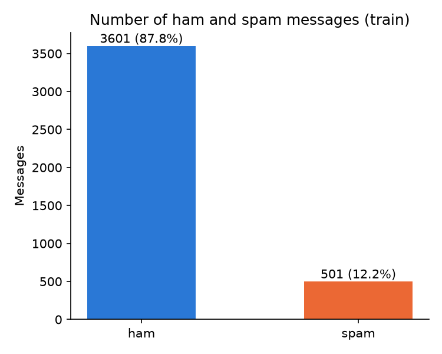
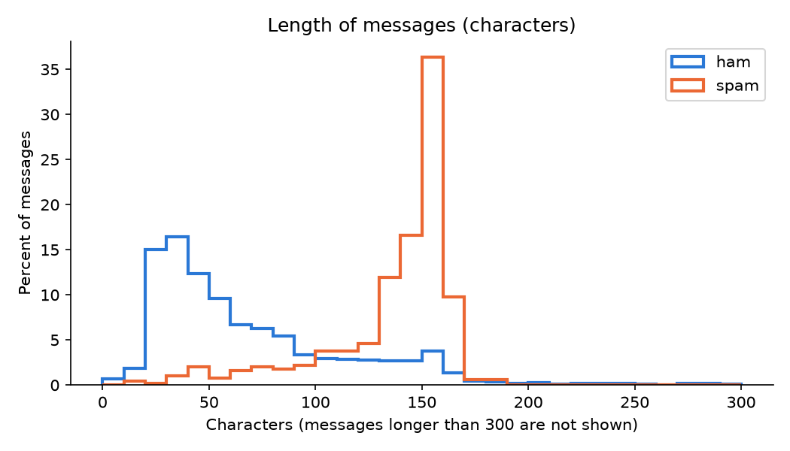
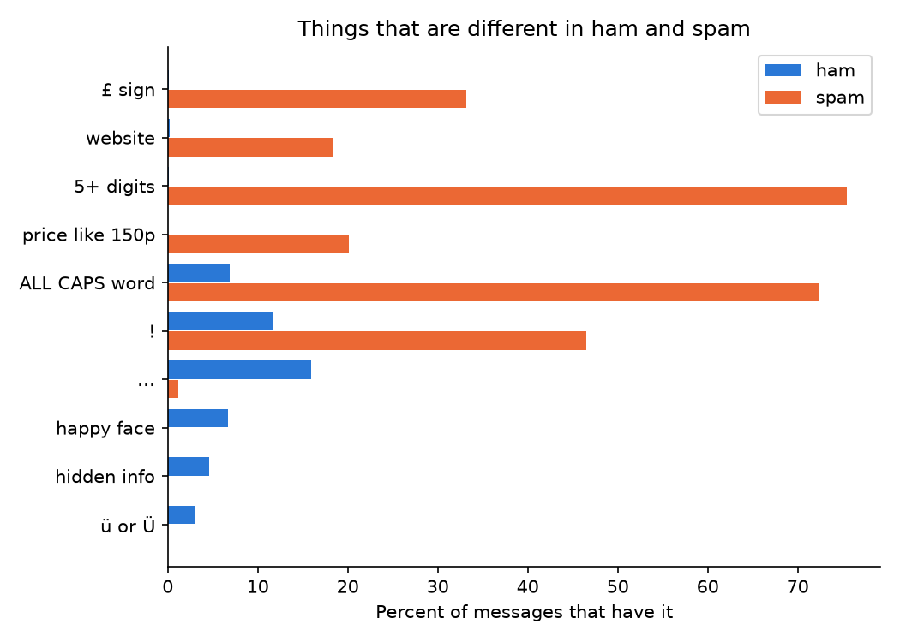
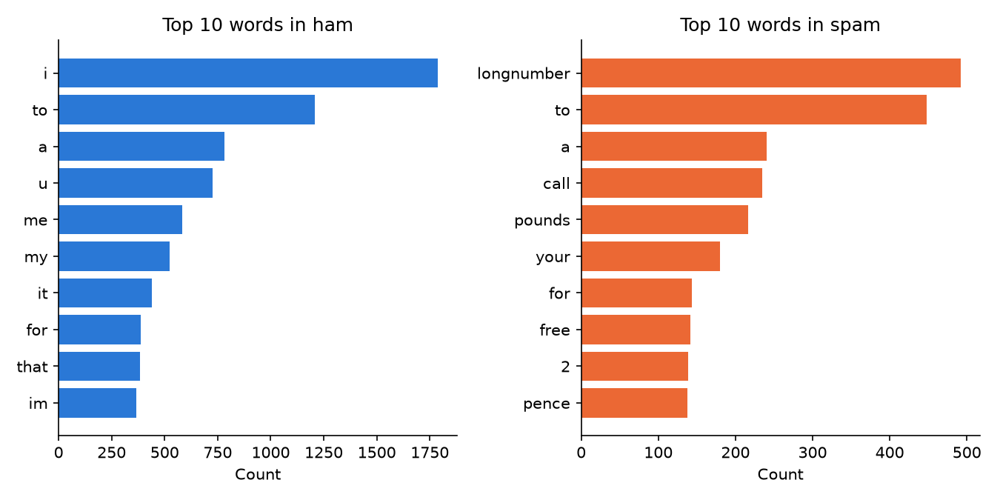

# SMS Spam Detection Report

Version 1.2

## 1. Introduction

Every day, people receive many SMS messages.
Most of them are normal, like messages from friends and family.
But some are unwanted, like ads, fake prizes, and
messages that try to trick people.
Normal messages are called "ham".
Unwanted messages are called "spam".

Imagine a telecommunications company that gets a huge
number of SMS messages every day.
The company wants a system that can read a message
and decide if it is ham or spam, without a person
checking it.

In this project, we work on this problem using NLP
(Natural Language Processing).
We use the SMS Spam Collection dataset from UCI.
It has 5,574 messages, and each one is labeled
as ham or spam.

Our plan has these steps:
- Look at the data and clean the text.
- Turn the messages into numbers and find similar messages.
- Build simple models to find spam.
- Build more advanced models.
- Compare all the models and choose the best one.

This version of the report covers the first part only:
how we looked at the data, fixed problems in it,
and prepared the text for the models (Task 1).
We will add the other parts when we finish them.

So far, we did these things:
- We looked at the raw file and understood how it is written.
- We loaded the data and found a problem: 5,572 rows instead of 5,574.
- We found the reason (a quote mark) and fixed it.
- We checked the data: no empty values, and the labels are correct.
- We found that most messages are ham (87%) and only 13% are spam.
- We found 403 repeated messages and deleted them.
- We split the data into training (4,136) and testing (1,035).
- We saved the two parts, so everyone in the team uses the same files.
- Later, we checked the repeated messages again in a better way.
  We found 43 more copies and made version 2 of the split.
- We studied what is different between ham and spam.
- We cleaned the text, removed stopwords, and did stemming.

Files we have now:
- `data/SMSSpamCollection`: the original data file.
- `data/train.csv` and `data/test.csv`: the split from week 1 (old, not used now).
- `data/train_v2.csv`: the training messages, version 2 (4,102).
- `data/test_v2.csv`: the testing messages, version 2 (1,026).
- `data/train_clean_v2.csv` and `data/test_clean_v2.csv`: the text after cleaning.
- `data/train_prep_v2.csv` and `data/test_prep_v2.csv`: the text after cleaning,
  stopwords and stemming.
- `notebooks/01_load_and_split.ipynb`: our notebook from week 1.
- `notebooks/01_load_and_split_v2.ipynb`: our notebook for version 2.
- `notebooks/02_cleaning_v2.ipynb`: cleaning the text.
- `notebooks/03_stopwords_stemming.ipynb`: stopwords and stemming.
- `notebooks/04_charts.ipynb`: the charts in this report.

## 2. Data and Setup

### The data

The file has 5,574 lines.
Each line has a label, then a tab, then the message.
There are two labels:
- ham: 4,827 messages
- spam: 747 messages

Most messages are ham (about 87%).
No message is empty, and every label is "ham" or "spam".

### A problem when loading

When we first read the file, we got 5,572 rows.
Two rows were missing.
Three lines were joined into one row.
The reason was a quote mark (") at the start of a message.
We told pandas to ignore quote marks.
After that we got all 5,574 rows.

### Repeated messages (week 1)

We found 403 messages that were exactly the same
as another message.
The same message never had two different labels.
We deleted them. We had 5,171 messages.

### Splitting (week 1)

We split the data into two parts:
- Train: 4,136 messages (80%)
- Test: 1,035 messages (20%)

We kept the same share of spam in both parts.
We used a fixed random seed (42), so we get the same split every time.

### A better check for copies (version 2)

Later we found more copies.
They were the same message with small changes,
like a capital letter, a space, or a dot at the end.
For example:
- "... within 28 days"
- "... within 28 days."

To find them, we made a "key" for each message:
the message in small letters, with only letters and numbers.
If two messages have the same key, they are the same message.

Two messages had no letters or numbers (":)" and ":-) :-)").
For them, the key is the message itself,
because they are not copies of each other.

With the key, we found 446 copies (43 more than before).
The same key never had two different labels.
We removed the copies.
Now we have 5,128 messages:
- ham: 4,502
- spam: 626

### Splitting (version 2)

We split the data again with the same settings as before.
- Train: 4,102 messages (3,601 ham and 501 spam)
- Test: 1,026 messages (901 ham and 125 spam)

We checked the keys: no message is in both train and test.
We saved the two parts in `data/train_v2.csv` and `data/test_v2.csv`.
From now on, all our work and all our models use these two files.

## 3. Task 1: Text Preprocessing

In this part we study the messages and prepare the text.
We make every choice by looking at the train data only.
Then we use the same choices on the test data.

### 3.1 Ham and spam in the train data

- ham: 3,601 messages (87.8%)
- spam: 501 messages (12.2%)

Most messages are ham.
This means a model can be right 87.8% of the time
just by saying "ham" every time.
So when we test our models later,
we must not look at accuracy only.

### 3.2 Length of messages

| | ham | spam |
|---|---|---|
| Average length (characters) | 71 | 136 |
| Middle length (characters) | 53 | 148 |
| Middle number of words | 11 | 25 |

Spam messages are about two times longer than ham messages.
Spam is also very regular: 69% of spam messages
have between 130 and 160 characters.
Ham messages are short most of the time,
but some are very long (the longest has 910 characters).

### 3.3 What is different between ham and spam?

We counted how many ham and spam messages have each thing.

| Thing | ham | spam |
|---|---|---|
| £ sign | 0.1% | 33.1% |
| A website (www, http, .com ...) | 0.2% | 18.4% |
| T&C (terms and conditions) | 0% | 10.6% |
| 5 or more digits together | 0.1% | 75.4% |
| Phone number with spaces (0800 542 0578) | 0% | 2.6% |
| Price like 150p | 0% | 20.2% |
| A word in CAPITAL letters | 6.9% | 72.5% |
| ! | 11.7% | 46.5% |
| ... | 15.9% | 1.2% |
| Happy face like :) | 6.7% | 0% |
| Sad face :( | 0.7% | 0% |
| Hidden info like `&lt;#&gt;` | 4.6% | 0% |
| ü or Ü (short for "you") | 3.1% | 0% |

What we learned:
- Spam has money, prices, websites, phone numbers and
  short codes (numbers with 5 digits). Spam wants you to
  call, text or visit something.
- Spam uses CAPITAL letters and "!" much more.
- Ham uses faces like :) and "...", like people do with friends.
- Some ham messages have hidden info like `&lt;#&gt;`.
  In the original data, some numbers and times were hidden
  with these codes. They are only in ham.

### 3.4 The most common words

- In ham, the top words are about the person: "i", "me", "my".
- In spam, the top words are about the reader and the offer:
  "call", "your", "free", and our special words
  "longnumber", "pounds" and "pence" (see 3.5).

### 3.5 Cleaning the text

We wrote one cleaning function.
Every rule comes from what we found in 3.3.
The rules are used in this order:

1. Faces like :) :D :P become "happyface", and :( becomes "sadface".
   Faces are only in ham, so we keep them as a word.
2. All letters become small letters,
   so "FREE", "Free" and "free" are the same word.
3. Hidden info like `&lt;#&gt;` becomes "hiddeninfo".
4. Other codes like `&amp;` are removed.
5. Websites become "url".
6. Money with £ becomes "pounds", and money with $ becomes "dollars".
7. Prices like 150p become "pence".
8. Phone numbers and numbers with 5 or more digits become "longnumber".
9. Apostrophes are removed, so "don't" becomes "dont".
10. All forms of T&C (T&C, T&Cs, T's and C's, T Cs) become "tandc".
11. Any other symbol becomes a space. We keep the letter ü.
12. We split the message into words using the spaces (tokenization).

Why we change these things into words and do not delete them:
each phone number or price is different,
so the model would see thousands of different numbers.
But "longnumber" and "pence" are one word each,
and they are strong signs of spam.

Why the order matters:
- Faces come before small letters, because :D and :P use capital letters.
- Websites come before removing symbols,
  or the dot in ".com" is lost.
- Money and prices come before long numbers,
  so £10000 becomes "pounds" and not "longnumber".
- T&C comes after the apostrophes,
  so "T's and C's" first becomes "ts and cs".

Checks after cleaning:
- The rules work as we wanted. For example, "happyface" is in
  230 ham messages and 0 spam messages, and "tandc" is in
  0 ham messages and 56 spam messages.
- No message became empty.
- Different words in train: 11,802 before cleaning and 7,303 after.
- The same clean text never has two different labels.

### 3.6 Style of the message

Cleaning removes capital letters, "!" and "...".
But we saw in 3.3 that they are different in ham and spam.
So before cleaning, we save them as numbers in new columns:

| Column | Meaning | ham average | spam average |
|---|---|---|---|
| length | number of characters | 71.04 | 136.42 |
| caps | words in CAPITAL letters | 0.40 | 1.93 |
| excl | number of "!" | 0.18 | 0.70 |
| dots | number of "..." | 0.27 | 0.01 |

### 3.7 Stopwords

Stopwords are very common small words, like "the", "to" and "my".
Many projects remove all of them.
We used the English list from NLTK (196 words).

But first we checked if they are the same in ham and spam.
61 stopwords are common (in 3% or more of ham or spam messages).
Many of them are very different between the two classes:

| Word | ham | spam |
|---|---|---|
| won | 0% | 9.0% |
| your | 7.4% | 30.7% |
| now | 6.2% | 25.3% |
| from | 3.3% | 17.4% |
| i | 34.9% | 5.0% |
| my | 12.2% | 1.4% |
| but | 8.7% | 1.0% |

If we remove these words, we lose useful signs.
So we made our own stopwords list:
- We keep a stopword if one class uses it
  at least 2 times more than the other class.
  This gave 39 words to keep (like "won", "your", "now", "i", "my").
- We remove the other 157 stopwords.

We compared the two ways on the train data:

| Text | All words | Different words | Empty messages |
|---|---|---|---|
| Before removing stopwords | 63,880 | 7,303 | 0 |
| Remove all 196 stopwords | 37,752 | 7,137 | 3 |
| Remove our 157 stopwords | 51,804 | 7,176 | 1 |

Removing all stopwords also empties some messages completely,
for example "What you doing?how are you?".
With our list, only one message became empty ("Where @").
For this message, we keep its clean text, so no message is lost.

### 3.8 Stemming

Stemming cuts the end of a word to get its root.
We used the Porter stemmer. Some examples:

| Word | Root |
|---|---|
| running | run |
| messages | messag |
| university | univers |
| universe | univers |
| likely | like |
| went | went |

What we learned:
- The root is not always a real word ("messag").
- Sometimes words with different meanings get the same root
  ("university" and "universe", "like" and "likely").
  This is called over-stemming.
- Sometimes words from the same word do not get the same root
  ("go" and "went"). This is called under-stemming.
- The stemmer also changes our special words
  ("happyface" becomes "happyfac"), so we do not stem them.

Stemming joined many forms of the same word.
For example: care, cared, careful, carefully, cares, caring -> "care".
Different words in train: 7,176 before stemming and 5,967 after.

### 3.9 Before and after

Spam example:
- Before: This is the 2nd time we have tried 2 contact u. U have won the
  £750 Pound prize. 2 claim is easy, call 087187272008 NOW1! Only 10p per minute.
  BT-national-rate.
- Clean: this is the 2nd time we have tried 2 contact u u have won the pounds
  pound prize 2 claim is easy call longnumber now1 only pence per minute bt national rate
- No stopwords: this 2nd time tried 2 contact u u won pounds pound prize 2 claim
  easy call longnumber now1 only pence per minute bt national rate
- Stemmed: thi 2nd time tri 2 contact u u won pounds pound prize 2 claim easi
  call longnumber now1 onli pence per minut bt nation rate

Ham example:
- Before: Boo what time u get out? U were supposed to take me shopping today. :(
- Clean: boo what time u get out u were supposed to take me shopping today sadface
- No stopwords: boo what time u get u supposed to take me shopping today sadface
- Stemmed: boo what time u get u suppos to take me shop today sadface

### 3.10 Three versions of the text

We saved three versions of the text for each message:
- `clean_text`: after cleaning
- `stop_text`: after removing our stopwords
- `stem_text`: after removing our stopwords and stemming

We do not know yet which version works best for the models.
So we keep all three and we will test them later.

### 3.11 Limits

Our cleaning is not perfect:
- Some people wrote a dot instead of an apostrophe ("I.ll").
  This becomes two words ("i ll"). This is in 26 ham messages.
- "T-Mobile" becomes "t mobile".
- 4 spam messages in test have the same clean text as a message in train.
  They are not copies: they are the same spam message
  with a different phone number or prize. After cleaning,
  numbers become "longnumber", so they look the same.
  We kept them, because spam really repeats like this.
