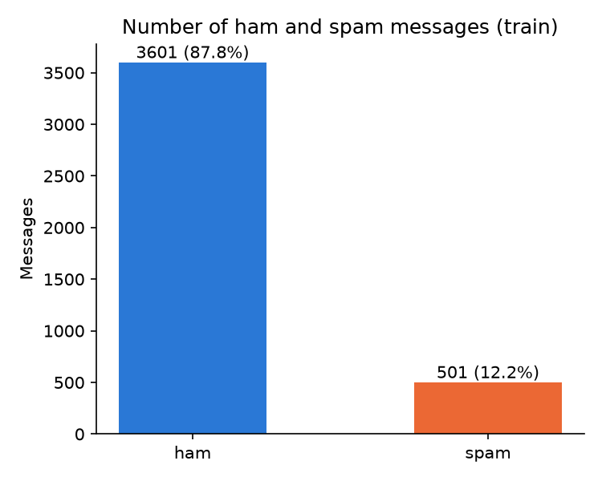
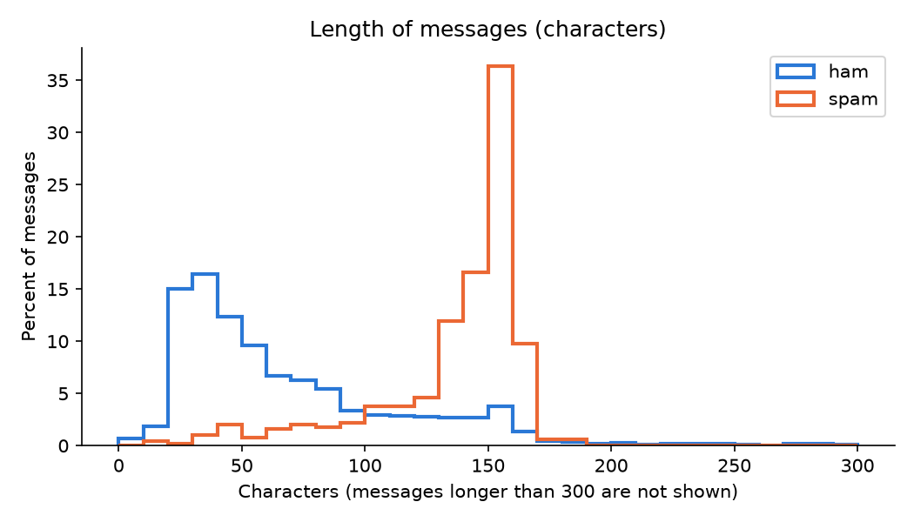
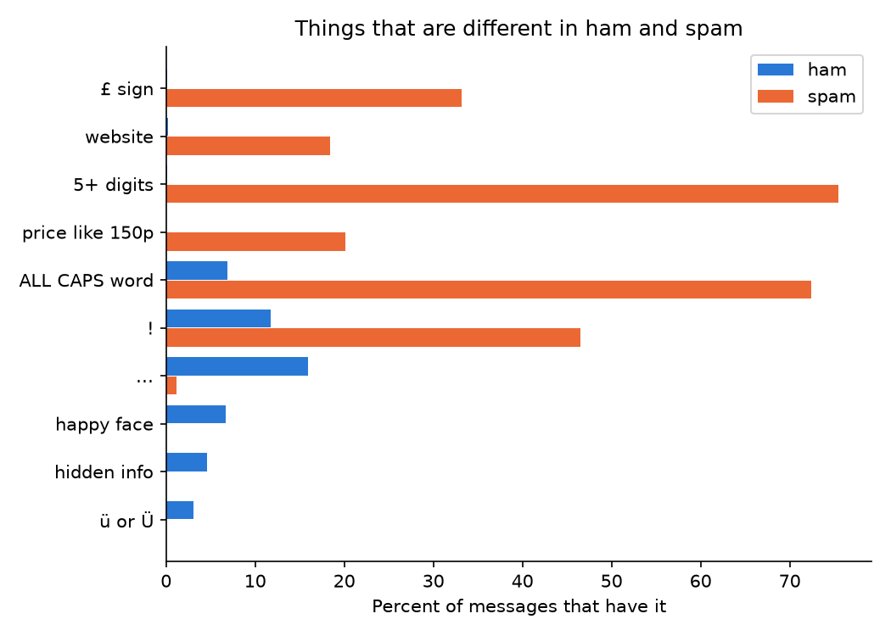
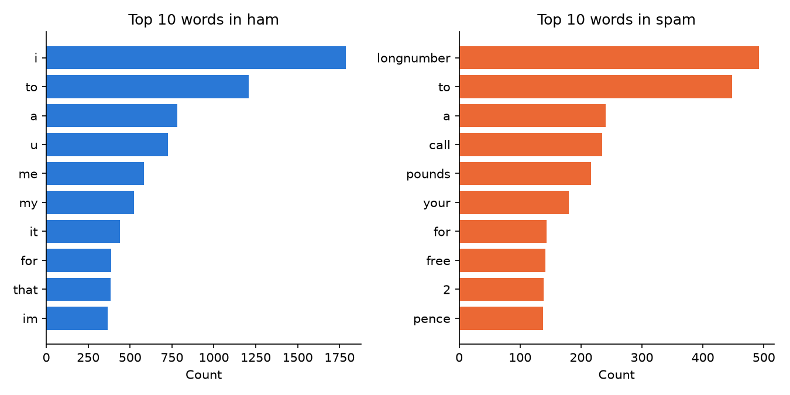
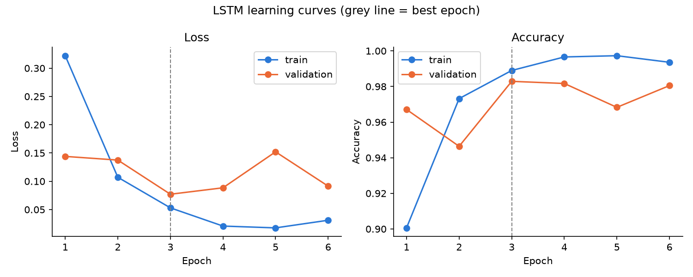
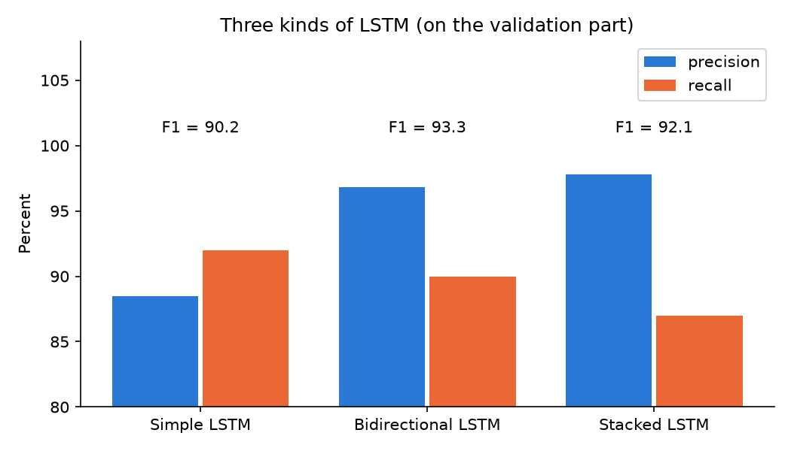
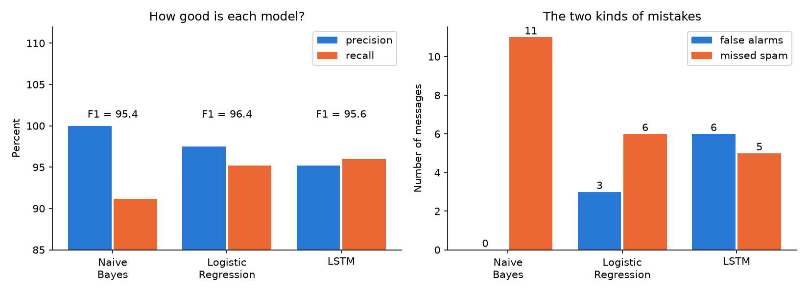

# SMS Spam Detection Report

Version 1.4

## 1. Introduction

Every day, people receive many SMS messages.
Most of them are normal, like messages from friends and family.
But some are unwanted, like ads, fake prizes, and
messages that try to trick people.
Normal messages are called "ham".
Unwanted messages are called "spam".

Imagine a telecommunications company that gets a huge
number of SMS messages every day.
The company wants a system that can read a message
and decide if it is ham or spam, without a person
checking it.

In this project, we work on this problem using NLP
(Natural Language Processing).
We use the SMS Spam Collection dataset from UCI.
It has 5,574 messages, and each one is labeled
as ham or spam.

Our plan has these steps:
- Look at the data and clean the text.
- Turn the messages into numbers and find similar messages.
- Build simple models to find spam.
- Build more advanced models.
- Compare all the models and choose the best one.

This version of the report covers the first four parts:
how we looked at the data, fixed problems in it,
prepared the text for the models (Task 1),
turned the messages into numbers (Task 2),
built two simple models (Task 3),
and built an LSTM model (Task 4).
We will add the other parts when we finish them.

So far, we did these things:
- We looked at the raw file and understood how it is written.
- We loaded the data and found a problem: 5,572 rows instead of 5,574.
- We found the reason (a quote mark) and fixed it.
- We checked the data: no empty values, and the labels are correct.
- We found that most messages are ham (87%) and only 13% are spam.
- We found 403 repeated messages and deleted them.
- We split the data into training (4,136) and testing (1,035).
- We saved the two parts, so everyone in the team uses the same files.
- Later, we checked the repeated messages again in a better way.
- We found 43 more copies and made version 2 of the split.
- We studied what is different between ham and spam.
- We cleaned the text, removed stopwords, and did stemming.
- We turned the messages into numbers with TF-IDF and found messages that are alike.
- We built two models (Naive Bayes and Logistic Regression), compared them, and looked at the messages they got wrong.
- We built an LSTM model, tried two other types of LSTM, and compared the LSTM with the first two models.

Files we have now:
- `data/SMSSpamCollection`: the original data file.
- `data/train.csv` and `data/test.csv`: the split from week 1 (old, not used now).
- `data/train_v2.csv`: the training messages, version 2 (4,102).
- `data/test_v2.csv`: the testing messages, version 2 (1,026).
- `data/train_clean_v2.csv` and `data/test_clean_v2.csv`: the text after cleaning.
- `data/train_prep_v2.csv` and `data/test_prep_v2.csv`: the text after cleaning,
  stopwords and stemming.
- `data/pred_nb.csv` and `data/pred_lr.csv`: the answers of Naive Bayes
  and Logistic Regression on the test messages.
- `data/pred_lstm.csv`: the answers of the LSTM on the test messages.
- `data/lstm_history.csv`: loss and accuracy of the LSTM after each epoch.
- `data/lstm_variants.csv`: results of the three LSTM types on the validation data.
- `data/model_comparison.csv`: the results of all models.
- `data/all_predictions.csv`: the answers of all models for each test message.
- `notebooks/01_load_and_split.ipynb`: our notebook from week 1.
- `notebooks/01_load_and_split_v2.ipynb`: our notebook for version 2.
- `notebooks/02_cleaning_v2.ipynb`: cleaning the text.
- `notebooks/03_stopwords_stemming.ipynb`: stopwords and stemming.
- `notebooks/04_charts.ipynb`: the charts for Task 1.
- `notebooks/05_tfidf_similarity.ipynb`: TF-IDF and cosine similarity.
- `notebooks/06_naive_bayes.ipynb`: Naive Bayes.
- `notebooks/07_logistic_regression.ipynb`: Logistic Regression.
- `notebooks/08_compare_errors.ipynb`: comparing the two models and their mistakes.
- `notebooks/09_lstm.ipynb`: the LSTM model.
- `notebooks/10_lstm_variants.ipynb`: Bidirectional and Stacked LSTM.
- `notebooks/11_lstm_errors.ipynb`: comparing the LSTM with the other models.
- `notebooks/12_lstm_charts.ipynb`: the charts for Task 4.

## 2. Data and Setup

### The data

The file has 5,574 lines.
Each line has a label, then a tab, then the message.
There are two labels:
- ham: 4,827 messages
- spam: 747 messages

Most messages are ham (about 87%).
No message is empty, and every label is "ham" or "spam".

### A problem when loading

When we first read the file, we got 5,572 rows.
Two rows were missing.
Three lines were joined into one row.
The reason was a quote mark (") at the start of a message.
We told pandas to ignore quote marks.
After that we got all 5,574 rows.

### Repeated messages (week 1)

We found 403 messages that were exactly the same
as another message.
The same message never had two different labels.
We deleted them. We had 5,171 messages.

### Splitting (week 1)

We split the data into two parts:
- Train: 4,136 messages (80%)
- Test: 1,035 messages (20%)

We kept the same share of spam in both parts.
We used a fixed random seed (42), so we get the same split every time.

### A better check for copies (version 2)

Later we found more copies.
They were the same message with small changes,
like a capital letter, a space, or a dot at the end.
For example:
- "... within 28 days"
- "... within 28 days."

To find them, we made a "key" for each message:
the message in small letters, with only letters and numbers.
If two messages have the same key, they are the same message.

Two messages had no letters or numbers (":)" and ":-) :-)").
For them, the key is the message itself,
because they are not copies of each other.

With the key, we found 446 copies (43 more than before).
The same key never had two different labels.
We removed the copies.
Now we have 5,128 messages:
- ham: 4,502
- spam: 626

### Splitting (version 2)

We split the data again with the same settings as before.
- Train: 4,102 messages (3,601 ham and 501 spam)
- Test: 1,026 messages (901 ham and 125 spam)

We checked the keys: no message is in both train and test.
We saved the two parts in `data/train_v2.csv` and `data/test_v2.csv`.
From now on, all our work and all our models use these two files.

## 3. Task 1: Text Preprocessing

In this part we study the messages and prepare the text.
We make every choice by looking at the train data only.
Then we use the same choices on the test data.

### 3.1 Ham and spam in the train data

- ham: 3,601 messages (87.8%)
- spam: 501 messages (12.2%)

Most messages are ham.
This means a model can be right 87.8% of the time
just by saying "ham" every time.
So when we test our models later,
we must not look at accuracy only.

### 3.2 Length of messages

| | ham | spam |
|---|---|---|
| Average length (characters) | 71 | 136 |
| Middle length (characters) | 53 | 148 |
| Middle number of words | 11 | 25 |

Spam messages are about two times longer than ham messages.
Spam is also very regular: 69% of spam messages
have between 130 and 160 characters.
Ham messages are short most of the time,
but some are very long (the longest has 910 characters).

### 3.3 What is different between ham and spam?

We counted how many ham and spam messages have each thing.

| Thing | ham | spam |
|---|---|---|
| £ sign | 0.1% | 33.1% |
| A website (www, http, .com ...) | 0.2% | 18.4% |
| T&C (terms and conditions) | 0% | 10.6% |
| 5 or more digits together | 0.1% | 75.4% |
| Phone number with spaces (0800 542 0578) | 0% | 2.6% |
| Price like 150p | 0% | 20.2% |
| A word in CAPITAL letters | 6.9% | 72.5% |
| ! | 11.7% | 46.5% |
| ... | 15.9% | 1.2% |
| Happy face like :) | 6.7% | 0% |
| Sad face :( | 0.7% | 0% |
| Hidden info like `&lt;#&gt;` | 4.6% | 0% |
| ü or Ü (short for "you") | 3.1% | 0% |

What we learned:
- Spam has money, prices, websites, phone numbers and
  short codes (numbers with 5 digits). Spam wants you to
  call, text or visit something.
- Spam uses CAPITAL letters and "!" much more.
- Ham uses faces like :) and "...", like people do with friends.
- Some ham messages have hidden info like `&lt;#&gt;`.
  In the original data, some numbers and times were hidden
  with these codes. They are only in ham.

### 3.4 The most common words

- In ham, the top words are about the person: "i", "me", "my".
- In spam, the top words are about the reader and the offer:
  "call", "your", "free", and our special words
  "longnumber", "pounds" and "pence" (see 3.5).

### 3.5 Cleaning the text

We wrote one cleaning function.
Every rule comes from what we found in 3.3.
The rules are used in this order:

1. Faces like :) :D :P become "happyface", and :( becomes "sadface".
   Faces are only in ham, so we keep them as a word.
2. All letters become small letters,
   so "FREE", "Free" and "free" are the same word.
3. Hidden info like `&lt;#&gt;` becomes "hiddeninfo".
4. Other codes like `&amp;` are removed.
5. Websites become "url".
6. Money with £ becomes "pounds", and money with $ becomes "dollars".
7. Prices like 150p become "pence".
8. Phone numbers and numbers with 5 or more digits become "longnumber".
9. Apostrophes are removed, so "don't" becomes "dont".
10. All forms of T&C (T&C, T&Cs, T's and C's, T Cs) become "tandc".
11. Any other symbol becomes a space. We keep the letter ü.
12. We split the message into words using the spaces (tokenization).

Why we change these things into words and do not delete them:
each phone number or price is different,
so the model would see thousands of different numbers.
But "longnumber" and "pence" are one word each,
and they are strong signs of spam.

Why the order matters:
- Faces come before small letters, because :D and :P use capital letters.
- Websites come before removing symbols,
  or the dot in ".com" is lost.
- Money and prices come before long numbers,
  so £10000 becomes "pounds" and not "longnumber".
- T&C comes after the apostrophes,
  so "T's and C's" first becomes "ts and cs".

Checks after cleaning:
- The rules work as we wanted. For example, "happyface" is in
  230 ham messages and 0 spam messages, and "tandc" is in
  0 ham messages and 56 spam messages.
- No message became empty.
- Different words in train: 11,802 before cleaning and 7,303 after.
- The same clean text never has two different labels.

### 3.6 Style of the message

Cleaning removes capital letters, "!" and "...".
But we saw in 3.3 that they are different in ham and spam.
So before cleaning, we save them as numbers in new columns:

| Column | Meaning | ham average | spam average |
|---|---|---|---|
| length | number of characters | 71.04 | 136.42 |
| caps | words in CAPITAL letters | 0.40 | 1.93 |
| excl | number of "!" | 0.18 | 0.70 |
| dots | number of "..." | 0.27 | 0.01 |

### 3.7 Stopwords

Stopwords are very common small words, like "the", "to" and "my".
Many projects remove all of them.
We used the English list from NLTK (196 words).

But first we checked if they are the same in ham and spam.
61 stopwords are common (in 3% or more of ham or spam messages).
Many of them are very different between the two classes:

| Word | ham | spam |
|---|---|---|
| won | 0% | 9.0% |
| your | 7.4% | 30.7% |
| now | 6.2% | 25.3% |
| from | 3.3% | 17.4% |
| i | 34.9% | 5.0% |
| my | 12.2% | 1.4% |
| but | 8.7% | 1.0% |

If we remove these words, we lose useful signs.
So we made our own stopwords list:
- We keep a stopword if one class uses it
  at least 2 times more than the other class.
  This gave 39 words to keep (like "won", "your", "now", "i", "my").
- We remove the other 157 stopwords.

We compared the two ways on the train data:

| Text | All words | Different words | Empty messages |
|---|---|---|---|
| Before removing stopwords | 63,880 | 7,303 | 0 |
| Remove all 196 stopwords | 37,752 | 7,137 | 3 |
| Remove our 157 stopwords | 51,804 | 7,176 | 1 |

Removing all stopwords also empties some messages completely,
for example "What you doing?how are you?".
With our list, only one message became empty ("Where @").
For this message, we keep its clean text, so no message is lost.

### 3.8 Stemming

Stemming cuts the end of a word to get its root.
We used the Porter stemmer. Some examples:

| Word | Root |
|---|---|
| running | run |
| messages | messag |
| university | univers |
| universe | univers |
| likely | like |
| went | went |

What we learned:
- The root is not always a real word ("messag").
- Sometimes words with different meanings get the same root
  ("university" and "universe", "like" and "likely").
  This is called over-stemming.
- Sometimes words from the same word do not get the same root
  ("go" and "went"). This is called under-stemming.
- The stemmer also changes our special words
  ("happyface" becomes "happyfac"), so we do not stem them.

Stemming joined many forms of the same word.
For example: care, cared, careful, carefully, cares, caring -> "care".
Different words in train: 7,176 before stemming and 5,967 after.

### 3.9 Before and after

Spam example:
- Before: This is the 2nd time we have tried 2 contact u. U have won the
  £750 Pound prize. 2 claim is easy, call 087187272008 NOW1! Only 10p per minute.
  BT-national-rate.
- Clean: this is the 2nd time we have tried 2 contact u u have won the pounds
  pound prize 2 claim is easy call longnumber now1 only pence per minute bt national rate
- No stopwords: this 2nd time tried 2 contact u u won pounds pound prize 2 claim
  easy call longnumber now1 only pence per minute bt national rate
- Stemmed: thi 2nd time tri 2 contact u u won pounds pound prize 2 claim easi
  call longnumber now1 onli pence per minut bt nation rate

Ham example:
- Before: Boo what time u get out? U were supposed to take me shopping today. :(
- Clean: boo what time u get out u were supposed to take me shopping today sadface
- No stopwords: boo what time u get u supposed to take me shopping today sadface
- Stemmed: boo what time u get u suppos to take me shop today sadface

### 3.10 Three versions of the text

We saved three versions of the text for each message:
- `clean_text`: after cleaning
- `stop_text`: after removing our stopwords
- `stem_text`: after removing our stopwords and stemming

We do not know yet which version works best for the models.
So we keep all three and we will test them later.

### 3.11 Limits

Our cleaning is not perfect:
- Some people wrote a dot instead of an apostrophe ("I.ll").
  This becomes two words ("i ll"). This is in 26 ham messages.
- "T-Mobile" becomes "t mobile".
- 4 spam messages in test have the same clean text as a message in train.
  They are not copies: they are the same spam message
  with a different phone number or prize. After cleaning,
  numbers become "longnumber", so they look the same.
  We kept them, because spam really repeats like this.

## 4. Task 2: TF-IDF and Cosine Similarity

### 4.1 What is TF-IDF?

A model cannot read words, so we turn each message into numbers.
TF-IDF gives every word in a message a weight:
- TF: how many times the word is in this message.
- IDF: how rare the word is in all the messages.

A word gets a big weight if it is in this message
but rare in the other messages.
A word that is in almost every message, like "to", gets a small weight.

We learn the words and the IDF from the train data only.
Then we use them on the test data, without learning anything new.
This is important: if we learn from the test data,
the test is not a fair exam any more.

### 4.2 Our setting for one-letter words

By default, TF-IDF in sklearn drops words with only one letter.
But we saw in Task 1 that one-letter words are very different
in ham and spam: "i" is in 34.9% of ham and 5.0% of spam,
and "ü" is only in ham.
So we changed the setting to keep them.

| Setting | Number of words |
|---|---|
| Default | 7,266 |
| Ours | 7,303 |

### 4.3 Example

For this spam message:
"please call amanda with regard to renewing or upgrading
your current t mobile handset free of charge offer ends today
tel longnumber subject to tandc"

the words with the biggest weight are:
amanda, regard, subject, renewing, upgrading (0.284 each),
then current (0.248) and handset (0.243).

Common words like "to" and "with" got a very small weight.

### 4.4 New words in the test data

TF-IDF only knows the words it learned from the train data.
In the test data, 1,027 words out of 16,109 (6.4%) are new,
and the model ignores them.
This is normal, and it is one reason why a model is never perfect.

### 4.5 Cosine similarity

Cosine similarity tells how much two messages are alike.
It gives a number between 0 and 1:
- 1 means the two messages use the same words with the same weights.
- 0 means they share no word.

We compared every train message with every other train message:

| | Average similarity |
|---|---|
| ham with ham | 0.022 |
| spam with spam | 0.064 |
| ham with spam | 0.017 |

Spam messages are about three times more alike than ham messages.
This is because spam comes from campaigns:
the same message is sent many times with a different
phone number or a different prize.

### 4.6 Finding messages that are alike

For each test message, we found the train message most like it.

Example (spam):
- Test: "WINNER!! As a valued network customer you have been
  selected to receivea £900 prize reward"
- Most alike in train (0.642): "WINNER! As a valued network customer
  you hvae been selected to receive a £900 re..."

The two messages are the same template.
One of them even has a spelling mistake ("hvae"),
but TF-IDF still found it.

Example (ham):
- Test: "sir, you will receive the account no another 1hr time.
  Sorry for the delay."
- Most alike in train (0.422): "Sorry for the delay. Yes masters"

Then we checked: does the most alike message have the same label?

| | Same label |
|---|---|
| All test messages | 98.4% |
| Only spam | 89.6% |
| Only ham | 99.7% |

The average best similarity is 0.642 for spam and 0.390 for ham.
So a spam message almost always finds a close twin in the train data,
but a ham message does not.

This also shows that TF-IDF alone is already useful for our problem.

## 5. Task 3: Naive Bayes and Logistic Regression

### 5.1 How we chose the settings

We must not choose the settings by looking at the test result.
If we do that, we pick what works on the test,
and the test is not a fair exam any more.

So we used cross-validation on the train data:
we cut the train data into 5 parts, train on 4 parts and test on 1,
and we repeat this 5 times. Then we take the average.
The test data is used one time only, at the end.

We also used F1 and not accuracy to choose,
because our data has much more ham than spam.

### 5.2 Naive Bayes

Naive Bayes learns how often each word is in ham and in spam.
For a new message, it asks: is this group of words
more like ham or more like spam?

We tried our three text versions and five values of alpha.
Alpha is a small number the model adds to every word count,
so a word it never saw does not get a probability of zero.

Best results in the cross-validation:

| Text | alpha | F1 |
|---|---|---|
| clean_text | 0.05 | 93.5 |
| stop_text | 0.05 | 93.4 |
| stop_text | 0.10 | 93.3 |

The three text versions gave almost the same result.
But alpha mattered a lot: with alpha = 1.0 the F1 was only 79.3,
and with alpha = 0.05 it was 93.5.

Result on the test data (clean_text, alpha = 0.05):

| | Said ham | Said spam |
|---|---|---|
| True ham | 901 | 0 |
| True spam | 11 | 114 |

- Accuracy: 98.9
- Precision: 100.0
- Recall: 91.2
- F1: 95.4

Naive Bayes never sent a normal message to the spam box,
but it missed 11 spam messages.

### 5.3 Logistic Regression

Logistic Regression gives each word a weight.
A positive weight pushes the message to spam,
a negative weight pushes it to ham.
It adds the weights of all the words and decides.

We tried our three text versions, three values of C,
and two values of class_weight:
- C: how free the model is. A big C lets the weights grow.
- class_weight: with "balanced", the model gives more importance
  to spam messages, because they are fewer.

Best results in the cross-validation:

| Text | C | class_weight | F1 |
|---|---|---|---|
| stem_text | 100 | balanced | 96.0 |
| clean_text | 10 | balanced | 95.9 |
| stop_text | 10 | balanced | 95.9 |

Every row with "balanced" was better than every row without it.
So giving more importance to the smaller class really helped.

Result on the test data (stem_text, C = 100, balanced):

| | Said ham | Said spam |
|---|---|---|
| True ham | 898 | 3 |
| True spam | 6 | 119 |

- Accuracy: 99.1
- Precision: 97.5
- Recall: 95.2
- F1: 96.4

### 5.4 Which words matter most?

Logistic Regression can show us its weights.
The words that push most to spam are:

| Word | Weight |
|---|---|
| longnumber | 29.01 |
| url | 16.86 |
| pence | 13.37 |
| pounds | 13.11 |
| txt | 10.59 |
| repli (reply) | 8.40 |

The words that push most to ham are:

| Word | Weight |
|---|---|
| hiddeninfo | -6.80 |
| i | -6.35 |
| my | -5.63 |
| that | -4.85 |
| happyface | -4.62 |

This is an important result for us.
The four strongest spam words (longnumber, url, pence, pounds)
and two of the strongest ham words (hiddeninfo, happyface)
are words that we made ourselves in Task 1.
If we had deleted the numbers, the prices and the faces,
the model would have lost its best signs.

### 5.5 Comparing the two models

| Model | Accuracy | Precision | Recall | F1 |
|---|---|---|---|---|
| Naive Bayes | 98.9 | 100.0 | 91.2 | 95.4 |
| Logistic Regression | 99.1 | 97.5 | 95.2 | 96.4 |
| Always say "ham" | 87.8 | 0.0 | 0.0 | 0.0 |

We added a very simple model that always says "ham".
It gets 87.8% accuracy without doing anything.
This is why accuracy alone is not enough for our data.

Logistic Regression is better on F1 (96.4 against 95.4).
But the two models make different mistakes:
- Naive Bayes is very careful. It never sent a normal message
  to the spam box, but it missed 11 spam messages.
- Logistic Regression catches more spam (it missed only 6),
  but it sent 3 normal messages to the spam box.

For a telecom company, sending a normal message to the spam box
is usually worse than letting one spam message pass.
So the company must choose:
Naive Bayes if no false alarm is allowed,
Logistic Regression if catching more spam is more important.

The two models agree on 1,018 messages out of 1,026,
and disagree on only 8.

### 5.6 Error analysis

The spam messages that Logistic Regression missed (6 messages)
were all missed by Naive Bayes too. So they are hard for both.

The six messages:
- "TBS/PERSOLVO. been chasing us since Sept for£38 definitely not paying now..."
- "Do you ever notice that when you're driving, anyone going slower than you..."
- "Would you like to see my XXX pics they are so hot..."
- "Burger King - Wanna play footy at a top stadium?..."
- "LIFE has never been this much fun and great until you came in..."
- "Sorry I missed your call let's talk when you have the time. I'm on 07090201529"

Why they are hard:
- They do not have the usual spam signs.
  There is no price, no £ sign and no website.
- Some of them look like a normal message between friends
  ("Sorry I missed your call...", "LIFE has never been this much fun...").
- They are a little shorter than normal spam
  (132 characters against 140 on average).
- The models were not close to the right answer:
  the highest probability of spam on a missed message
  was only 0.494 for Naive Bayes and 0.292 for Logistic Regression.
  So this is not a small problem of a threshold.

The three false alarms of Logistic Regression:
- "Hi, Mobile no. `&lt;#&gt;` has added you in their contact list on
  www.fullonsms.com It s a great place to send free sms to people"
  (probability 0.992). This message really has a website and the word "free",
  so the mistake is understandable.
- "Glad to see your reply." (0.601) and
  "Are you free now?can i call now?" (0.544).
  These are short messages with words that are common in spam
  ("reply", "free", "call"). With few words,
  one or two spam words are enough to change the answer.

### 5.7 A check on repeated messages

In Task 1 we said that 4 test messages have the same clean text
as a message in the train data.
They are not copies: they are the same spam template
with a different phone number.

We checked if these 4 messages make our result look better than it is.
Both models got all 4 right.
If we remove them, the F1 goes from 95.4 to 95.2 for Naive Bayes,
and from 96.4 to 96.2 for Logistic Regression.
So the change is very small, and our result is not inflated.

## 6. Task 4: LSTM

### 6.1 What is an LSTM?

Naive Bayes and Logistic Regression look at a message
as a bag of words. They do not care about the order of the words.
An LSTM reads the message word by word, from the first word to the last.
It keeps a memory of what it read before,
and it decides what to keep and what to forget.
So it can use the order of the words.

We ran this task on Google Colab with a GPU
(TensorFlow 2.21.0 and Keras).

### 6.2 Preparing the text for the LSTM

We used the `clean_text` column, the same text as in Task 1.

1. Words to numbers. We gave each word in the train data a number.
   The most common words get the small numbers.
   Number 1 is for a word we do not know ("unknown"),
   and number 0 is for filling empty places (padding).
   We made the list from the train data only.
   The train data has 7,303 different words.
   With the unknown word and the padding, the list has 7,305 items.
   A word in the test data that is not in the list gets the number 1.
2. Same length. The LSTM needs messages with the same length.
   We chose 40 words. This covers 98.2% of the train messages.
   Messages with fewer words get zeros at the end.
   Messages with more words are cut after the 40th word.

   | Length | Messages covered |
   |---|---|
   | 30 words | 92.4% |
   | 40 words | 98.2% |
   | 50 words | 98.9% |
   | 60 words | 99.3% |
   | 80 words | 99.8% |

   The average train message has 15.6 words, and the longest has 189.
3. Labels. spam = 1 and ham = 0.
4. Validation data. We took a part of the train data
   to watch the model while it learns.
   We kept the same share of spam in both parts.

   | Part | Messages | Spam |
   |---|---|---|
   | Fit (the model learns from it) | 3,281 | 401 |
   | Validation (we only check) | 821 | 100 |

   The test data was not used until the end.

### 6.3 The model

The model has four layers:

| Layer | What it does | Size | Parameters |
|---|---|---|---|
| Embedding | gives each word a vector of numbers | 32 numbers per word | 233,760 |
| LSTM | reads the words one by one | 32 units | 8,320 |
| Dropout | turns off 30% of the numbers while training | 0.3 | 0 |
| Dense (sigmoid) | gives one number between 0 and 1 | 1 | 33 |

The model has 242,113 parameters in total.
Most of them (233,760) are in the Embedding layer,
because the list has 7,305 items and each item has 32 numbers.
The Embedding vectors are learned by the model itself.

Settings:
- Loss: binary crossentropy.
- Optimizer: Adam.
- Batch size: 32 messages.
- Maximum epochs: 20.
- Random seed: 42.

For the output, a number of 0.5 or more means spam.

### 6.4 When to stop training

We did not choose the number of epochs by hand.
We used early stopping: if the validation loss does not get better
for 3 epochs, the training stops,
and the model goes back to the weights of its best epoch.

| Epoch | Training loss | Validation loss | Validation accuracy |
|---|---|---|---|
| 1 | 0.3221 | 0.1440 | 96.7 |
| 2 | 0.1071 | 0.1375 | 94.6 |
| 3 | 0.0530 | 0.0771 | 98.3 |
| 4 | 0.0208 | 0.0885 | 98.2 |
| 5 | 0.0176 | 0.1521 | 96.8 |
| 6 | 0.0311 | 0.0914 | 98.1 |

- The best epoch was epoch 3 (validation loss 0.0771).
- The training stopped after epoch 6, because epochs 4, 5 and 6
  were not better than epoch 3.

After epoch 3, the training loss went down to 0.0176 (epoch 5),
but the validation loss went up (0.0885 and 0.1521).
This is overfitting: the model starts to remember
the train messages and not learn the general rule.

We checked that early stopping really gave us the best epoch:
after the training, the loss on the validation data was 0.0771.
This is the same as the loss of epoch 3.

### 6.5 Result on the test data

We used the same test data as the other models (1,026 messages).
This is the first time the LSTM saw the test data.

| | Said ham | Said spam |
|---|---|---|
| True ham | 895 | 6 |
| True spam | 5 | 120 |

- Accuracy: 98.9
- Precision: 95.2
- Recall: 96.0
- F1: 95.6

The LSTM said "spam" for 126 messages.
We saved all its answers in `data/pred_lstm.csv`.

### 6.6 Bidirectional and Stacked LSTM

We tried two other types of LSTM:
- Bidirectional: one LSTM reads the message from the first word
  to the last, and another LSTM reads it from the last word
  to the first. Then we join the two.
- Stacked: two LSTM layers, one on top of the other.
  The first layer gives an output for every word,
  and the second layer reads these outputs.

We used the same word numbers, the same length (40 words),
the same validation data, the same settings and the same random seed.
We compared the three types on the validation data (100 spam messages),
not on the test data.

| LSTM type | Parameters | Epochs | Best epoch | Precision | Recall | F1 |
|---|---|---|---|---|---|---|
| Simple | 242,113 | 5 | 2 | 88.5 | 92.0 | 90.2 |
| Bidirectional | 250,465 | 7 | 4 | 96.8 | 90.0 | 93.3 |
| Stacked | 250,433 | 6 | 3 | 97.8 | 87.0 | 92.1 |

What we see:
- The Bidirectional LSTM has the best F1 (93.3).
- The Simple LSTM has the best recall (92.0), but the lowest precision (88.5).
  It calls more normal messages spam.
- The Bidirectional and Stacked LSTM have about 8,000 more parameters.

Two things we must say:
- The Simple LSTM in this table is a new training run.
  It is not the same run as the model in 6.3 to 6.5.
  It stopped at epoch 5 and the first one stopped at epoch 6
  (see 6.9). So the numbers of the Simple LSTM can change.
- The validation data has only 100 spam messages.
  The difference in recall between the three types is 2 or 5 messages.
  So part of the difference between the types can be just chance.

The model in 6.3 to 6.5 is the Simple LSTM.
So the test result in 6.5 is not from the best type
on the validation data.
We did not test the Bidirectional LSTM on the test data.

### 6.7 Comparing with Naive Bayes and Logistic Regression

| Model | Accuracy | Precision | Recall | F1 | Ham called spam | Spam missed |
|---|---|---|---|---|---|---|
| Naive Bayes | 98.9 | 100.0 | 91.2 | 95.4 | 0 | 11 |
| Logistic Regression | 99.1 | 97.5 | 95.2 | 96.4 | 3 | 6 |
| LSTM | 98.9 | 95.2 | 96.0 | 95.6 | 6 | 5 |

What we see:
- Logistic Regression has the best F1 (96.4).
  The LSTM (95.6) is a little better than Naive Bayes (95.4).
- The LSTM misses the fewest spam messages (5),
  but it has the most false alarms (6).
- Naive Bayes has no false alarms, but it misses the most spam (11).

The three models are very close.
The test data has only 125 spam messages,
so one message changes the recall by 0.8 points.
We cannot say that one model is clearly better than the others.
The LSTM, which is the most complex model,
did not win against Logistic Regression.

Do the three models agree?
- All three agree on 1,010 messages out of 1,026.
  They disagree on 16 messages.
- 4 spam messages were missed by all three models.
  So these are hard for every model we have.
- The LSTM missed 5 spam messages: these 4, and one more.
  The one more is "RECPT 1/3. You have ordered a Ringtone.
  Your order is being processed...".
  Naive Bayes and Logistic Regression got this one right.
- The LSTM got 2 spam messages right that Naive Bayes and
  Logistic Regression both missed:
  "TBS/PERSOLVO. been chasing us since Sept for£38..." and
  "Burger King - Wanna play footy at a top stadium?...".
- The LSTM got "Glad to see your reply." and
  "Are you free now?can i call now?" right.
  Logistic Regression called them spam (see 5.6).

### 6.8 Error analysis

The LSTM has 6 false alarms (normal messages called spam).
Five of them were called spam only by the LSTM.
One of them was also called spam by Logistic Regression
(the message with the website www.fullonsms.com, see 5.6).

The six messages (the beginning of each):
- "Ee msg na poortiyagi odalebeku: Hanumanji 7 name 1-Hanuman..."
- "Hello-/@drivby-:0quit edrunk sorry iff pthis makes no senrd..."
- "Camera quite good, 10.1mega pixels, 3optical and 5digital dooms..."
- "Please reserve ticket on saturday eve from chennai to thirunelvali..."
- "Hi, Mobile no. `&lt;#&gt;` has added you in their contact list on www.fullonsms.com..."
- "We are pleased to inform that your application for Airtel Broadband is processed successfully..."

We think the false alarms may be messages with strange or rare words.
So we counted the words of each message that are not in the train data:

| Messages | Words that are new |
|---|---|
| The 6 false alarms | 25.0% |
| All ham messages in the test data | 6.3% |

The false alarms have four times more new words.
The LSTM gives all new words the same number (unknown).
So when a message has many new words, the LSTM knows less about it.
This can be a reason for these mistakes.
It is only a sign, because we have only 6 messages,
and we did not test this in another way.

### 6.9 Results can change a little

Keras can give different results in different sessions,
even when we fix the random seed.
We saw this with the Simple LSTM.
It has the same code and the same seed in two notebooks:

| Notebook | Epochs | Best epoch |
|---|---|---|
| 09_lstm | 6 | 3 |
| 10_lstm_variants | 5 | 2 |

So if someone runs the notebooks again, the numbers can change a little.
The numbers in this report are from the runs saved in our files.

### 6.10 Limits

- We have only 125 spam messages in the test data,
  so small differences between models are not strong proofs.
- We have only 100 spam messages in the validation data,
  so the comparison of the three LSTM types is not strong either.
- The LSTM list of words comes from 4,102 train messages only.
  Words that are not in the list are all treated the same.
- Messages longer than 40 words are cut (1.8% of the train messages),
  so the LSTM does not see the end of them.
- The LSTM is slower and harder to explain than Logistic Regression,
  which can show us the weight of each word.
